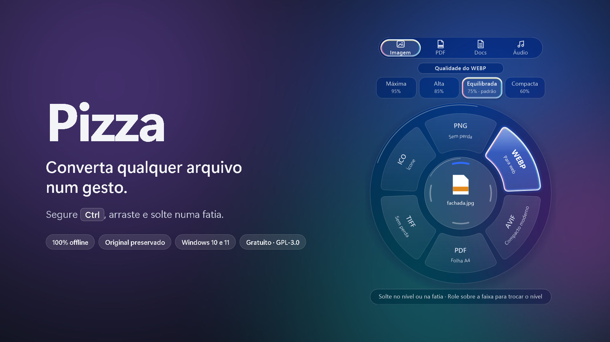
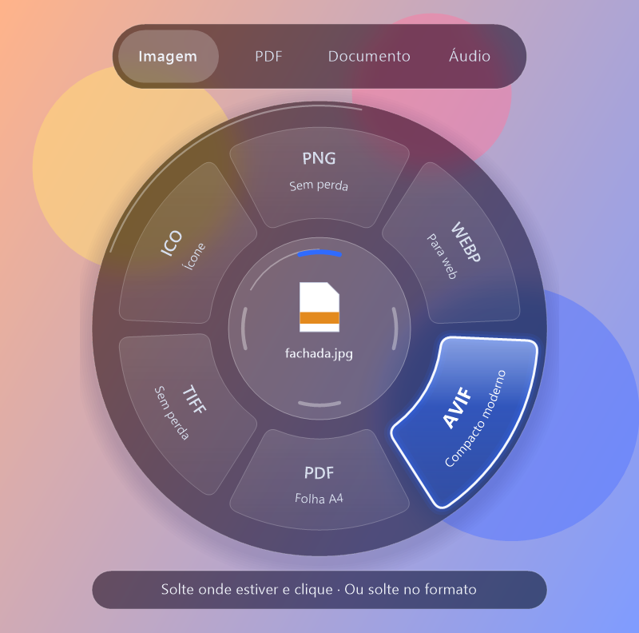

<div align="center">



[](https://github.com/GuiTiburcio/Pizza/actions/workflows/ci.yml)
[](https://github.com/GuiTiburcio/Pizza/actions/workflows/codeql.yml)


[](LICENSE)

**Ctrl + arrastar. Solte onde estiver. Clique no formato.**

*Afinal, tudo acaba em pizza.*

*"A perfeição não é alcançada quando não há mais nada a ser incluído. A perfeição é alcançada quando não há mais nada a ser retirado."* — Antoine de Saint-Exupéry

Conversor de arquivos para Windows com menu circular, processamento local e arquivo original preservado.

[](https://github.com/GuiTiburcio/Pizza/releases)

[Baixar](https://github.com/GuiTiburcio/Pizza/releases) · [Instalar](docs/5-operacao/INSTALACAO.md) · [Guia de TI](docs/5-operacao/TI-GPO.md) · [Como usar](docs/5-operacao/USO.md) · [Dossiê e design](docs/3-design/dossie/README.md) · [Documentação](docs/README.md) · [Próximas etapas](docs/1-produto/ROADMAP.md)

</div>

## O que é o Pizza

O Pizza abre um menu de formatos quando você começa a arrastar um arquivo segurando Ctrl. Você pode soltar o mouse em qualquer posição e escolher com um clique, ou arrastar diretamente até uma fatia. A saída fica ao lado do original.

O projeto está em **prévia de desenvolvimento**. Há conversores de Imagem, operações de PDF, documentos e áudio implementados; isso não significa que as quatro abas já tenham aceite de lançamento. Consulte os [critérios e as pendências do Brotinho](docs/4-entrega/BROTINHO-LANCAMENTO.md). Instaladores assinados e atualização automática ainda não estão disponíveis.

## Como funciona

<p align="center"></p>

1. Abra o Pizza; ele fica na bandeja do Windows.
2. Segure **Ctrl** e comece a arrastar uma imagem no Explorer ou na área de trabalho.
3. Solte o mouse **onde estiver**. A Pizza continua aberta para você clicar no formato. Soltar diretamente numa fatia também funciona.
4. Use a roda para ver mais opções. Os pontos do miolo indicam as voltas quando a aba tem mais de seis formatos.
5. Escolha as opções, quando houver, e confirme. **Esc** cancela; depois da soltura, clicar em outro aplicativo também fecha o menu.

O cartão de resultado permite abrir a saída ou mostrá-la na pasta. O menu do ícone dá acesso a **Arquivos...**, com o histórico da sessão, e **Sair**.

## Formatos desta prévia

| Entrada | Saída |
| --- | --- |
| JPG/JPEG, PNG, WEBP, AVIF, TIFF/TIF e GIF | JPG, PNG, WEBP, AVIF, PDF, TIFF, ICO e GIF |
| PDF | Juntar, dividir e girar páginas |
| DOCX | TXT e HTML |
| XLSX | CSV, um arquivo por planilha |
| MP3, M4A, AAC, FLAC e WAV | MP3, M4A/AAC ou ALAC, FLAC e WAV |

O catálogo omite conversões para o mesmo formato quando não há operação correspondente. GIFs são tratados como imagem estática nesta etapa. HEIC, BMP e vídeo ficam fora desta prévia. Juntar PDFs aceita várias entradas; isso não representa conversão genérica em lote. DOCX → Markdown continua planejado. DOCX/XLSX/PPTX → PDF depende do motor opcional do Pizza Jumbo, separado do Brotinho.

**Validação de Áudio:** os [testes do PR #84](https://github.com/GuiTiburcio/Pizza/pull/84) preservam integralmente o PCM ALAC nos casos de pacote completo/parcial, silêncio final, 16/24 bits e mono/estéreo/seis canais. Uma hora de áudio converteu em 94,77 s na CI, com hash do PCM preservado na releitura. O [PR #95](https://github.com/GuiTiburcio/Pizza/pull/95) exige confirmação antes de usar bitrate menor. Isso não substitui a matriz manual do candidato de lançamento nem valida todas as combinações de efeitos e conversões com perda; ver [critérios do Brotinho](docs/4-entrega/BROTINHO-LANCAMENTO.md).

**Portfólio:** o código, os testes, o [dossiê](docs/3-design/dossie/README.md) e os PRs mostram a evolução do projeto. Recursos planejados não são apresentados como entregues. As versões para [macOS e Linux](docs/1-produto/PORTABILIDADE.md) ainda estão no roteiro, sem data prometida.

## Processamento local

- Sem conta, telemetria ou upload de arquivos.
- Original aberto somente para leitura; nomes existentes recebem um número, sem sobrescrever.
- Conversor em processo isolado do Windows, sem rede, recebendo os arquivos por handles.
- Metadados pessoais removidos por padrão; preservação opcional nos formatos compatíveis.
- Registros técnicos locais sem nomes ou conteúdo dos arquivos.

Requisitos e limites estão nas [SPECS](docs/1-produto/SPECS.md). Recursos futuros descritos ali não representam funcionalidades já entregues; veja o [roteiro](docs/1-produto/ROADMAP.md).

## Experimentar e desenvolver

Os builds de desenvolvimento são produzidos pelo [GitHub Actions](https://github.com/GuiTiburcio/Pizza/actions/workflows/ci.yml). Abra uma execução bem-sucedida e baixe o artefato **pizza-win-x64**. Consulte os [requisitos e o preparo do Worker](docs/5-operacao/USO.md).

Para desenvolver, use Windows x64, **.NET 10 SDK** e **Visual Studio Build Tools com Desenvolvimento para desktop com C++**, exigido pelo NativeAOT:

```powershell
dotnet restore Pizza.slnx --locked-mode
dotnet build Pizza.slnx -c Release --no-restore
dotnet test Pizza.slnx -c Release --no-build
```

Para gerar uma cópia local de teste:

```powershell
.\tools\publicar-dev.ps1
```

Builds locais são para desenvolvimento. A distribuição oficial deve vir do CI. Veja [como contribuir](.github/CONTRIBUTING.md).

## Organização

| Pasta | Conteúdo |
| --- | --- |
| `src/Pizza.App` | Residente NativeAOT: bandeja, gesto, menu, painéis e notificações |
| `src/Pizza.Core` | Estados, geometria, catálogo, IPC e gravação segura |
| `src/Pizza.Converters` | Conversores executados pelo Worker |
| `src/Pizza.Worker` | Processo de conversão isolado |
| `tests` | Testes unitários, do drop, conversores e isolamento real |
| `docs` | Dossiê, especificações, uso, design e decisões |
| `tools` | Publicação de desenvolvimento, sons e verificação de logs |

## Inspiração

O Pizza nasceu depois que vi, por acaso, um vídeo no **TikTok**. Gostei da ideia de converter arquivos com um menu circular e decidi criar minha própria implementação para Windows. O vídeo inspirou o conceito; este repositório registra a construção do meu projeto. O nome vem do formato do menu, que lembra uma pizza fatiada, e do ditado "afinal, tudo acaba em pizza": aqui, todo arquivo arrastado acaba nela.

O link e o autor do vídeo ainda não foram identificados. Quando eu localizar a referência, adicionarei o crédito aqui. O planejamento e o design foram elaborados com o auxílio do Claude; o desenvolvimento conta com apoio do Claude e do Codex.

## Créditos e colaboradores

| Participação | Crédito |
| --- | --- |
| Idealização, decisões de produto e manutenção | [Guilherme Tiburcio](https://github.com/GuiTiburcio) |
| Apoio ao planejamento, design e desenvolvimento | [Claude / Claude Design](https://claude.ai/) |
| Apoio ao desenvolvimento, testes, revisão de código e organização do repositório | [Codex / OpenAI](https://github.com/openai/codex) |

Claude e Codex são as ferramentas de IA utilizadas na construção do projeto. As contribuições assistidas pelo Codex também recebem crédito de coautoria nos commits correspondentes.

## Dossiê e demonstração

O [**Pizza — Dossiê do Projeto**, criado no Claude Design](https://claude.ai/artifact/LMrbTPnaY6EbVK1UPjcVDs#page-dcb81aee8d83), reúne a referência visual do projeto. As [pranchas do dossiê](docs/3-design/dossie/README.md) também estão neste repositório, sem precisar de login no Claude. O que foi descartado no caminho, e por quê, está em [ideias descartadas](docs/7-melhoria/ideias-descartadas/README.md).

Uma demonstração prática em vídeo está planejada e será adicionada quando estiver pronta.

## Contribuição e licença

Leia [CONTRIBUTING.md](.github/CONTRIBUTING.md); vulnerabilidades devem seguir [SECURITY.md](.github/SECURITY.md).

Código sob [GPL-3.0](LICENSE). Dependências e licenças estão descritas em [THIRD-PARTY-NOTICES.md](THIRD-PARTY-NOTICES.md).
