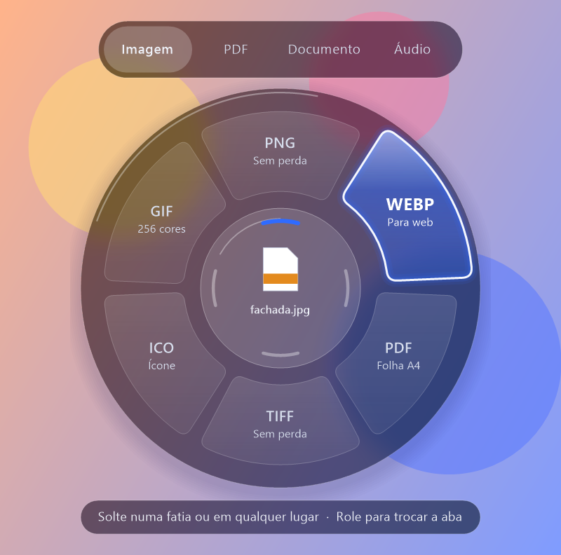
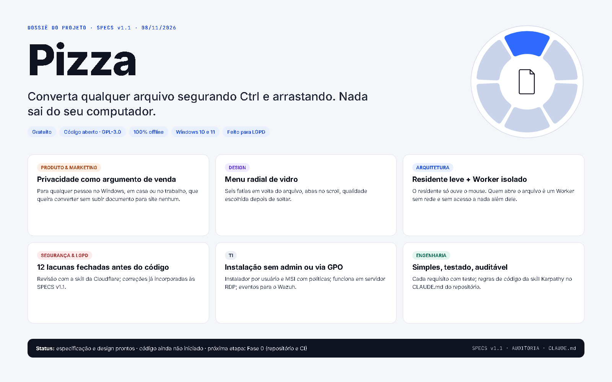
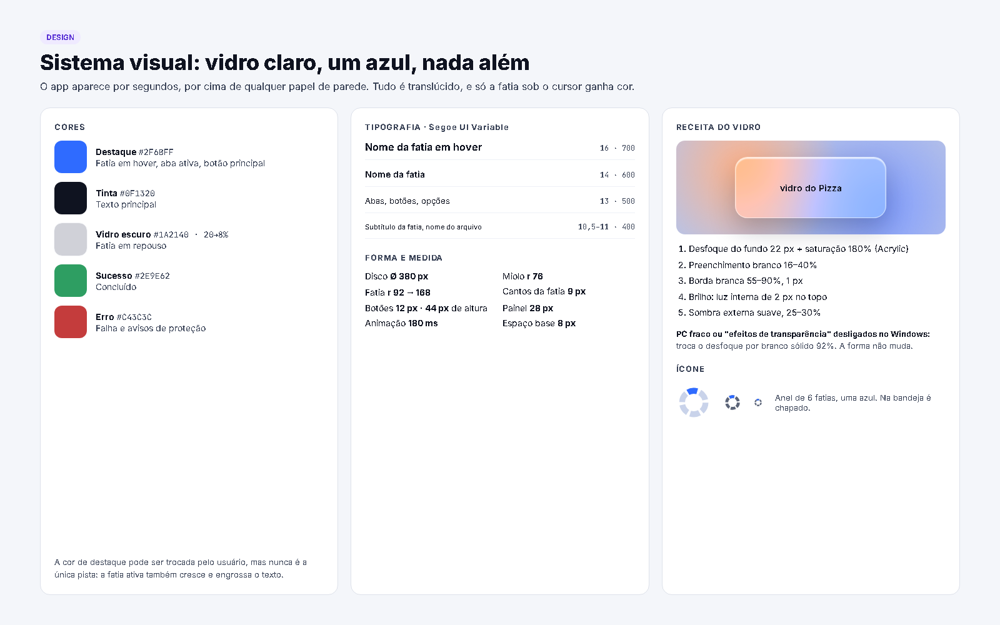
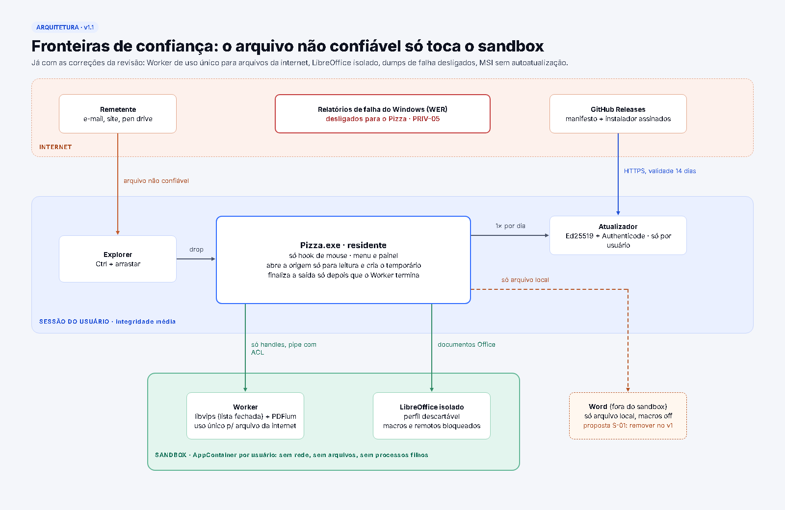
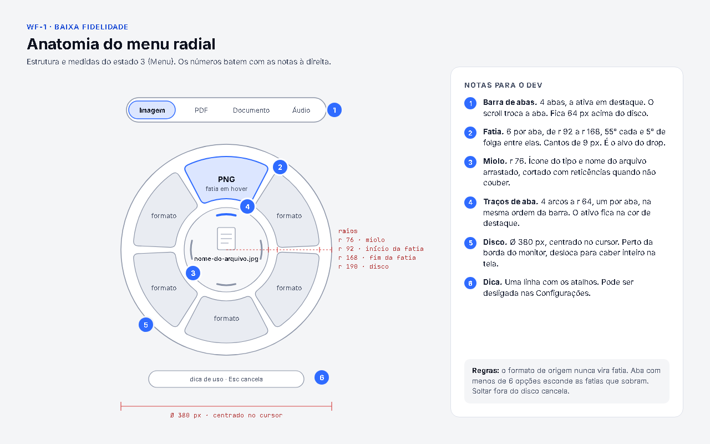
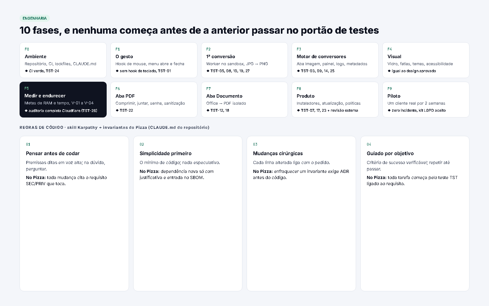

# Pizza

**Converta arquivos no Windows com um gesto.** Segure **Ctrl**, arraste o arquivo e escolha o formato num menu circular de vidro. Tudo acontece no seu PC: nada é enviado para a internet.

<p align="center">
  
</p>

<p align="center">
  Gratuito · Código aberto (GPL-3.0) · 100% offline · Windows 10 e 11
</p>

> **Status:** em desenvolvimento, rumo ao v1.0. A aba **Imagem** já converte de verdade. PDF, Documento e Áudio vêm nas próximas fases. Ainda não há instalador: por enquanto, o Pizza é compilado a partir do código (veja [Para desenvolver](#para-desenvolver)).

## De onde veio a ideia

O Pizza nasceu de um vídeo aleatório que vi no TikTok, com um menu circular para converter arquivos. Gostei tanto da ideia que resolvi criar a minha própria versão, do zero, com foco em privacidade e segurança. O código, o desenho e as decisões deste repositório são próprios.

## Como funciona

1. Segure **Ctrl** e comece a arrastar um arquivo, da área de trabalho ou do Explorer.
2. O menu abre no cursor, já na aba do tipo do arquivo. A roda do mouse troca a aba.
3. Escolha o formato de um destes jeitos:
   - **Solte numa fatia:** o atalho mais rápido.
   - **Solte em qualquer lugar** e depois **clique** no formato. **Esc** ou um clique fora cancela.
4. Ajuste as opções, se quiser. O arquivo novo aparece ao lado do original.

O original nunca é alterado, movido ou apagado.

## O que já converte

| Aba | Formatos | Opções |
| --- | --- | --- |
| Imagem | JPG, PNG, WEBP, PDF, TIFF, ICO e GIF, a partir de JPG, PNG, WEBP, TIFF, GIF ou AVIF | Qualidade, resolução, compressão, tamanho do ícone e manter metadados |
| PDF | Em breve | |
| Documento | Em breve | |
| Áudio | Em breve | |

Por padrão, GPS, autor e outros metadados saem do arquivo convertido.

Também já funcionam:

- avisos no canto da tela, com cancelamento e sons próprios;
- o painel **Arquivos**, com as conversões da sessão;
- os temas claro e escuro, que seguem o Windows.

## Privacidade e segurança

O Pizza abre arquivos que vieram de qualquer lugar, então foi desenhado para não confiar neles:

- **Nada sai do PC.** A única conexão prevista é a consulta de atualização.
- **Arquivo não confiável só é lido num processo isolado** (AppContainer), sem rede e sem acesso a outros arquivos. Ele recebe só o arquivo aberto, nunca um caminho.
- **Sem captura de teclado.** O Pizza só observa o mouse.
- **O registro técnico nunca guarda nomes de arquivo nem conteúdo.**
- **Cadeia de build travada:** dependências fixadas, ações do CI fixadas por SHA, CodeQL em cada PR e instalador gerado só pelo CI.

Detalhes nas [SPECS](docs/SPECS.md), na [auditoria de segurança](docs/security/AUDITORIA-SEGURANCA.md) e em [SECURITY.md](SECURITY.md).

## Dossiê do projeto

Antes da primeira linha de código, o Pizza foi planejado num dossiê visual: posicionamento, sistema visual, arquitetura, segurança, LGPD, implantação e wireframes.

<p align="center">
  <a href="docs/dossie/"></a>
</p>

| | |
| --- | --- |
| [](docs/dossie/des-1-sistema-visual.png) | [](docs/dossie/arq-1-fronteiras.png) |
| **Sistema visual:** vidro claro, um azul e nada além | **Arquitetura:** o arquivo não confiável só toca o sandbox |
| [](docs/dossie/wf-1-anatomia.png) | [](docs/dossie/eng-0-roteiro.png) |
| **Wireframe:** anatomia do menu radial | **Engenharia:** fases com portão de testes |

Todas as pranchas estão em [docs/dossie](docs/dossie/).

## Roteiro

| Fase | Entrega | Situação |
| --- | --- | --- |
| 0 a 3 | Ambiente e CI, gesto, primeira conversão, motor da aba Imagem | Concluídas |
| 4 | Visual de vidro, painéis, ícone da bandeja, temas e acessibilidade | Em andamento |
| 5 | Medições de RAM, CPU e tempo, e auditoria de segurança completa | A fazer |
| 6 | Aba PDF | A fazer |
| 7 | Aba Documento | A fazer |
| 8 | Produto: instalador, atualização assinada e políticas para a TI (v1.0) | A fazer |
| v1.x | Áudio e vídeo, aba Web e lotes | Depois do v1.0 |

## Documentação

Comece pelo [índice da documentação](docs/README.md). Os principais documentos:

- [SPECS](docs/SPECS.md): a fonte da verdade, com os requisitos de segurança (`SEC-`) e privacidade (`PRIV-`).
- [Visão geral do projeto](docs/PIZZA-PROJETO.md): produto, experiência, arquitetura, conversores e fases.
- [Decisões (ADRs)](docs/adr/): por que cada escolha foi feita.

## Para desenvolver

| Ferramenta | Para quê |
| --- | --- |
| [.NET 10 SDK](https://dotnet.microsoft.com/download/dotnet/10.0) | Compilar e testar |
| Visual Studio Build Tools com "Desenvolvimento para desktop com C++" | Linker exigido pelo NativeAOT |
| Git + GitHub CLI (`gh`) | Versionamento e PRs |

Compilar e testar:

```bash
dotnet build Pizza.slnx
```

```bash
dotnet test Pizza.slnx
```

Gerar uma cópia local para testar: o script publica o `Pizza.exe` nativo junto com o Worker e dá ao Worker isolado a permissão de ler a própria pasta.

```bash
.\tools\publicar-dev.ps1
```

Se o publish falhar com `'vswhere.exe' não é reconhecido`, falta a pasta do instalador do Visual Studio no PATH. Adicione `C:\Program Files (x86)\Microsoft Visual Studio\Installer` ao PATH do usuário e abra um terminal novo.

Para encerrar o Pizza, clique com o botão direito no ícone da bandeja e escolha **Sair**.

### Estrutura

| Pasta | Papel |
| --- | --- |
| `src/Pizza.App` | Residente `Pizza.exe` (NativeAOT): bandeja, hook de mouse, menu, painel e notificações |
| `src/Pizza.Core` | Gesto, catálogo de formatos, configuração, logs e contratos IPC |
| `src/Pizza.Worker` | `Pizza.Worker.exe`: converte dentro do sandbox |
| `src/Pizza.Converters` | Conversores por família de formato |
| `tests/` | Testes xUnit e amostras pequenas |
| `tools/` | Scripts de publicação local, sons e varredura de logs |
| `docs/` | SPECS, ADRs, auditoria e Dossiê |

O CI (GitHub Actions, Windows) compila, testa e publica o `Pizza.exe` nativo a cada PR e a cada push na `main`.

### Forma de trabalho

- Trabalho em branches `feat/…`, `fix/…` e `docs/…`, sempre por pull request.
- Commits em [Conventional Commits](https://www.conventionalcommits.org/pt-br/), em português: `feat(overlay): destaca fatia no hover`.
- Nomes no código em inglês; commits, documentação e interface em português.
- Regras para quem escreve código: [CLAUDE.md](CLAUDE.md).

## Licença

Gratuito e de código aberto, sob a [GPL-3.0](LICENSE) (veja o [ADR-014](docs/adr/014-gratuito-gpl.md)). Para reportar uma falha de segurança, veja [SECURITY.md](SECURITY.md).
