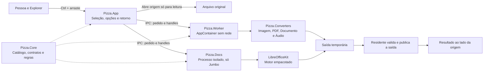

# Pizza — fundamentos para apresentação

**Estado conferido em 23/11/2026.** A referência integrada é o commit `289dd3b`. O Pizza é um conversor de arquivos para Windows, em prévia de desenvolvimento. A demonstração pode mostrar funções já entregues. Para saber o que ainda impede o lançamento, consulte a [previsão de entrega](../../4-entrega/PREVISAO-DE-ENTREGA.md).

## O problema que o Pizza resolve

Quem só quer converter um arquivo normalmente precisa abrir outro aplicativo, encontrar a opção, escolher uma pasta e depois localizar o resultado. O Pizza aproxima o comando do arquivo: a pessoa inicia com **Ctrl + arraste**, escolhe o formato e recebe a saída ao lado da origem. Isso reduz a troca de contexto e mantém a origem disponível para conferência.

O público inicial são pessoas e equipes em Windows que fazem conversões recorrentes e precisam manter o conteúdo no PC. A proposta dá prioridade a quatro abas no Brotinho: **Imagem, PDF, Documento e Áudio**. O Jumbo acrescenta um motor de documentos para conversões que precisam da diagramação. A experiência e os controles comuns permanecem na mesma base de código.

## Planta funcional

O desenho mostra o fluxo de execução. No código, o App usa o Core e inicia o Worker por IPC. O Worker usa o Core e os Converters. A saída provisória passa pelos controles do residente antes de receber um nome definitivo. As pranchas visuais e os diagramas históricos estão no [índice do dossiê](README.md).

## Decisões e razões

| Decisão | Por que foi tomada | Consequência e forma de demonstrar |
| --- | --- | --- |
| Menu radial no gesto e escolha por clique | O gesto abre o comando perto do cursor. A escolha por clique permite soltar e decidir com calma | Demonstre os dois caminhos. Mostre Voltar em Volume e Cancelar no painel. O teste interativo no candidato fica na matriz. [ADR-025](../../2-decisoes/025-escolha-por-clique-apos-o-gesto.md) |
| Esc pela janela ou pelo arraste do Windows | O cancelamento precisa funcionar no contexto do Pizza sem monitoramento global de teclas | Explique o limite de foco e demonstre o cancelamento antes da escrita. [ADR-016](../../2-decisoes/016-esc-sem-hook-de-teclado.md) |
| Windows primeiro, com residente NativeAOT | O gesto depende do Explorer e do arraste OLE. Começar por uma plataforma permite validar a interação e a fronteira de segurança com os mecanismos reais do sistema | A publicação do residente é parte da CI. macOS e Linux têm um roteiro próprio; controles de isolamento precisarão de provas por plataforma. [ADR-003](../../2-decisoes/003-nativeaot-win32-direct2d.md), [portabilidade](../../1-produto/PORTABILIDADE.md) |
| Residente leve e processamento em outro processo | Arquivos de entrada podem ser danificados. Separar a interface do parser limita o efeito de erros e dá um ponto para impor prazos e permissões | Demonstre um erro em arquivo sintético e uma conversão seguinte funcionando. O isolamento tem testes de processo real. [SPECS, SEC-20 a SEC-28](../../1-produto/SPECS.md) |
| IPC por pipes sem nome e handles | O residente abre os arquivos e entrega ao Worker apenas os acessos necessários. O pedido não precisa transportar caminhos dos arquivos | Explique que um handle é um acesso já aberto pelo Windows. Os testes verificam leitura da origem pelo handle e negação de acesso a arquivos fora do isolamento. [ADR-021](../../2-decisoes/021-pipe-sem-nome.md) |
| Origem somente leitura e saída provisória | Cancelamento, erro de conversão e colisão de nomes não devem alterar o arquivo da pessoa nem deixar um resultado incompleto | Converta duas vezes, compare o hash da origem e mostre nomes distintos. [SPECS, SEC-31 a SEC-37 e TST-10](../../1-produto/SPECS.md) |
| Sem conversão por serviço externo | O conteúdo deve permanecer no PC. Reduzir dependência de rede também permite converter offline | Faça uma demonstração offline. A consulta de atualização é um fluxo separado e previsto nas SPECS, sem enviar dados de conversão. [SPECS, PRIV-03 e SEC-50](../../1-produto/SPECS.md) |
| Remover metadados pessoais por padrão | Uma cópia convertida pode revelar autor, comentários ou dados de câmera sem que apareçam na tela | Compare os metadados de um fixture antes e depois. Mostre o que foi preservado, como título, orientação ou DPI quando aplicável. A revisão integrada é o [PR #111](https://github.com/GuiTiburcio/Pizza/pull/111). [ADR-036](../../2-decisoes/036-limites-de-saida-e-metadados.md) |
| Limites de entrada, saída, memória e tempo | Um arquivo não deve monopolizar recursos da estação. Uma saída grande demais deve falhar de maneira explícita | Mostre o cenário controlado de limite. O endurecimento da cópia de entrada e da limpeza do Jumbo segue em revisão. [ADR-036](../../2-decisoes/036-limites-de-saida-e-metadados.md), [PR #113](https://github.com/GuiTiburcio/Pizza/pull/113) |
| QPDF e PDFium com papéis separados | Operações de página e renderização têm requisitos diferentes. A escolha também considerou a licença da dependência que seria usada antes | Mostre Girar, Dividir, Juntar, Imagens e Texto. Senha e AES-256, Comprimir e PDF → DOCX ainda têm gates próprios. [ADR-033](../../2-decisoes/033-pdfium-e-qpdf.md) |
| Brotinho e Jumbo no mesmo código | Conversões simples funcionam com o pacote leve. Preservar diagramação em formatos Office exige um motor adicional, mais pesado e com outra superfície de teste | Mostre quais opções são comuns e quais dependem do Jumbo. A composição dos dois ZIPs ainda está em revisão. [ADR-034](../../2-decisoes/034-brotinho-jumbo-motor-de-documentos.md), [PR #112](https://github.com/GuiTiburcio/Pizza/pull/112) |
| Manifestar os formatos conforme a entrada e a edição | A interface precisa dizer o que o arquivo pode virar e evitar botões que parecem prometer recursos indisponíveis | Apresente uma entrada incompatível, o retorno da interface e uma opção que funciona. Web, vídeo e lote geral continuam no roteiro futuro. [ADR-039](../../2-decisoes/039-formatos-por-pacote-e-fatias-incompativeis.md) |
| Confirmação antes de reduzir bitrate | Uma limitação do codec não pode derrubar a qualidade sem a escolha da pessoa | Mostre a oferta, cancele e confirme que nada foi gravado. Repita aceitando e confira a taxa. [PR #95](https://github.com/GuiTiburcio/Pizza/pull/95) |
| Referência Apple para o ALAC sem perda | A finalização pelo codificador do Windows podia falhar em trechos curtos. O novo caminho grava pacotes parciais e duração real | Apresente como correção em revisão. Há testes de amostras, duração, ordem de canais e concorrência. As mudanças estão nos [PRs #109](https://github.com/GuiTiburcio/Pizza/pull/109) e [#119](https://github.com/GuiTiburcio/Pizza/pull/119). O caminho integrado anterior é descrito no [ADR-035](../../2-decisoes/035-aba-audio-media-foundation.md). |
| Prévia identificada por commit, artefato e inventário | Revisores precisam saber exatamente o que testaram. Hash detecta alteração do pacote e SBOM identifica componentes | Mostre SHA, artefato e resultados juntos. Assinatura e fluxo de atualização verificada continuam critérios próprios do Estável. [ADR-031](../../2-decisoes/031-previa-pelo-ci.md), [critérios de lançamento](../../4-entrega/BROTINHO-LANCAMENTO.md) |
| Código aberto e inventário de terceiros | O mantenedor escolheu permitir que outras pessoas leiam o código e contribuam. Componentes externos têm licenças e versões próprias | Aponte para a [licença do Pizza](../../../LICENSE) e os [avisos de terceiros](../../../THIRD-PARTY-NOTICES.md). [ADR-014](../../2-decisoes/014-gratuito-gpl.md) |
| Uma tarefa por worktree e documentação por responsabilidade | Trabalho paralelo precisa preservar mudanças isoladas e deixar o motivo da alteração fácil de encontrar | Mostre o fluxo requisito → ADR → código → teste → evidência. A organização documental e o gerenciador entraram pelos [PRs #108](https://github.com/GuiTiburcio/Pizza/pull/108) e [#110](https://github.com/GuiTiburcio/Pizza/pull/110). |

Os ADRs são os registros detalhados de cada decisão. Use o [índice completo](../../2-decisoes/README.md) para consultar contexto, alternativas e consequências. As [SPECS](../../1-produto/SPECS.md) definem o comportamento esperado, com as emendas vigentes.

## Roteiro de demonstração

1. Explique o problema em 30 segundos. “Quando só preciso mudar o formato de um arquivo, quero fazer isso perto dele e manter o original intacto.”
2. Converta uma imagem sintética. Mostre escolha, progresso e resultado ao lado da origem.
3. Faça uma escolha, volte ou cancele. Mostre como conferir o resultado em Arquivos e como Desfazer atua sobre a cópia criada.
4. Mostre PDF ou DOCX com metadados fictícios. Compare a saída com o original e explique a fronteira entre o residente e o Worker.
5. Feche com as edições, o que está integrado e o próximo gate. Use o SHA do pacote demonstrado e as evidências da matriz.

Se perguntarem se está pronto para lançamento, distinga **demonstração**, **piloto** e **v1.0 estável**. CI verde verifica o candidato automatizado. O uso real por arraste, a auditoria de lançamento e a distribuição têm critérios e evidências próprios.

## Como manter o dossiê atualizado

A mudança deve atualizar o documento correspondente no mesmo PR. Se mudar o comportamento, atualize as SPECS e o roteiro de aceite. Se mudar arquitetura, dependência ou fronteira de privacidade, registre a decisão num ADR e atualize a planta. Se mudar a experiência, vincule a prancha à revisão e ao resultado do teste no aplicativo. Registre no relatório de entrega o SHA, o que foi previsto, o que aconteceu e o que segue pendente. Use este documento para a síntese e os ADRs para o detalhe.
