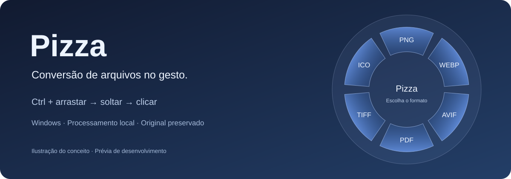

# Pizza — Dossiê do Projeto

**[Abrir o artefato original no Claude Design](https://claude.ai/artifact/LMrbTPnaY6EbVK1UPjcVDs#page-dcb81aee8d83)**

**[Ver as pranchas do dossiê no GitHub, sem login no Claude](../dossie/README.md)**

As pranchas exportadas foram recuperadas do trabalho que o Claude deixou no PR #28. São referências de planejamento; quando divergirem do comportamento atual, prevalecem as SPECS e os ADRs.

O artefato foi compartilhado pelo mantenedor como referência visual do projeto. Ele permanece hospedado no Claude; este link preserva a origem. O endereço exige login no Claude no acesso verificado em 10/11/2026. O GitHub não executa esse artefato dentro do README.

O [dossiê consolidado em Markdown](../PIZZA-PROJETO.md) reúne produto, UX, wireframes, sistema visual, arquitetura e roteiro. Ele preserva o planejamento feito com o auxílio do Claude. O [documento de requisitos](../SPECS.md) contém as emendas técnicas que prevalecem sobre decisões antigas. O [roteiro da prévia](../ROADMAP.md) mostra o que já funciona.

A ilustração acima foi preparada para a apresentação do repositório; não é uma captura do artefato nem da aplicação.

Decisões recentes: [GDI+ e vidro](../adr/023-vidro-gdiplus-desfoque-proprio.md), [AVIF e voltas](../adr/024-avif-e-voltas-de-fatias.md) e [escolha por clique](../adr/025-escolha-por-clique-apos-o-gesto.md).
